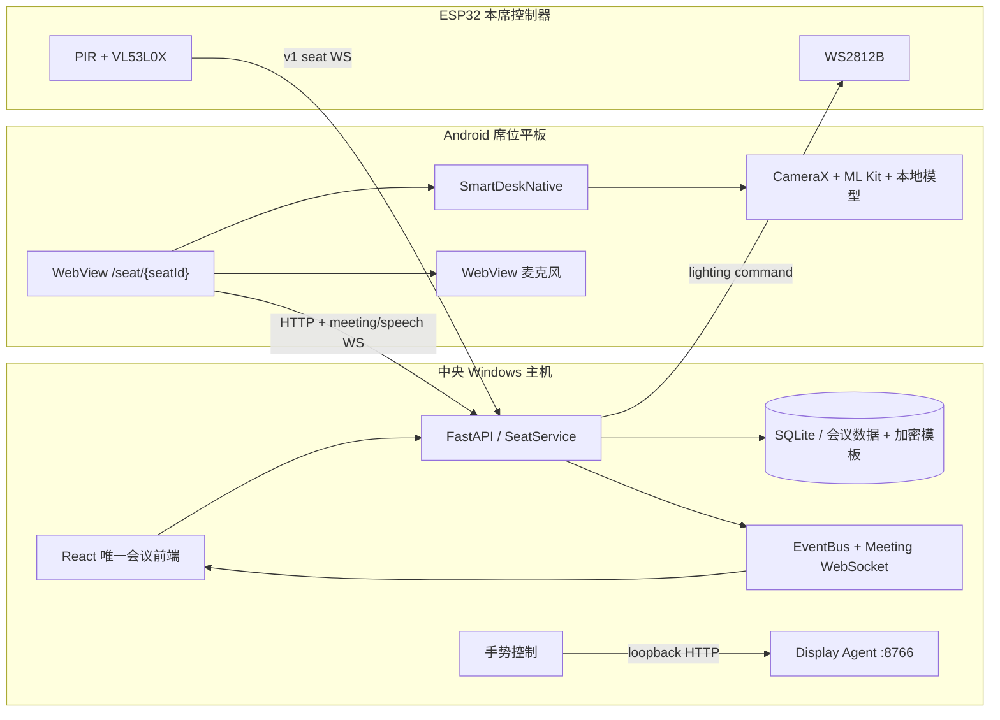

# Android/ESP32 集成架构

## 决策

`smart_desk` 是唯一正式产品仓库，但各程序保持独立构建和运行：

- `new_coding_desk/backend` 是会议业务、数据库和实时状态唯一权威源；
- `new_coding_desk/frontend` 是唯一会议业务前端；
- `android_tablet` 只提供 WebView 和 Android 原生能力；
- `esp32_seat_controller` 只提供本席传感器、灯光和设备通信；
- `smartdesk_gesture_controller` 保持中央主机模块；
- Display Agent 是 Windows 窗口发现、切换和激活的唯一实现。

原平板仓库的 `v0.8.0-face-prototype` 是历史人脸基线，不再并行开发正式
Android 产品代码。`android_tablet/diagnostic-web` 是诊断工具，不是第二套
会议界面。

## 运行拓扑

## 数据所有权

| 数据 | 权威源 | 禁止行为 |
|---|---|---|
| 会议、议程、投票、服务呼叫 | FastAPI/数据库 | Android 或 ESP32 自建副本 |
| 席位状态与签到绑定 | `SeatService` | 路由、Android 直接写表 |
| 稳定人员与参会人关系 | `Person`、`Attendee.person_id` | 用临时 `attendee_id` 作为人脸键 |
| 原始人脸照片、诊断裁剪 | Android App 临时内存/私有诊断区 | 上传中央数据库或状态页 |
| 中央人脸模板 | FastAPI 加密模板库（按 `Person.id`） | 明文保存、日志输出或跨模型混用 |
| 本席目标模板 | Seat 2–9 Android Keystore 加密存储 | 下发其他席位人员、Seat 1 保存 81 人本地识别库、旧会议复用 |
| 本席身份与占用 | Android + `SeatService` | ESP32 传感器决定入座 |
| 本席灯态与硬件诊断 | ESP32 + 后端聚合 | ESP32 决定会议业务 |
| Windows 应用激活 | Display Agent | 手势模块复制窗口控制 |

## 关键流程

### 入座与签到

1. Seat 2–9 检测到活动会议后，先注册本机 RSA 公钥并下载只含本席分配人员的设备加密模板包；Seat 1 使用主持人本机模板。
2. Android 校验会议、模型、流水线、维度和版本，原子替换本地加密模板后才调用
   `NativeBridge.startFaceVerification(personId)`；同步失败不得使用旧会议模板。
3. Android 对分配人员执行 1:1 验证并派发带唯一 `eventId` 的 `identity_status`。
4. 仅 `VERIFIED + VALIDATED` 由前端携设备令牌调用
   `POST /api/seats/{seatId}/identity-checkin`。
5. 后端认证设备、校验时效和等级，将 `Person` 映射到活动会议的
   `Attendee`，再调用同一 `SeatService.check_in`。
6. 空座入座、Seat、Attendee、幂等事件在一个事务中提交，之后依次广播
   `seat_occupied`、`check_in`。
7. LightingManager 下发 `WELCOME`；ESP32 以 `command_id` ACK，5 秒后恢复
   原基础灯态。

### 语音

正式路径只有网页麦克风。Android `WebChromeClient` 只向已配置的正式席位来源
授予音频资源；前端上传 16 kHz、单声道 PCM16 到语音 WebSocket。Activity
暂停、演讲席切换、取消或 WebSocket 中断会释放资源。没有长期并存的
`AudioRecord` 第二路径。

### 运维状态

`GET /api/hardware/status` 分别聚合 `tablets` 与 `seats` 两个通道。平板经
认证心跳报告能力和版本；ESP32 以协议心跳、ACK 和传感器诊断报告状态。状态页
只读，不包含照片、embedding、诊断裁剪或原始音频；只显示模板集版本、数量、
同步结果和脱敏错误。

## 部署模式

`config/smartdesk.integration.json` 的 `deploy_mode`：

| 值 | 用途 | 中央主机串口 |
|---|---|---|
| `central` | 单机/Arduino 台架 | 可打开 |
| `distributed` | 兼容 Windows Seat Agent | 不打开 |
| `esp32` | 正式新席位路径 | 不打开 |

ESP32 正式会话必须先完成 v1 `hello`、Bearer 设备认证、席位绑定和最低固件
版本检查；`distributed` 的旧无版本消息不会在 `esp32` 模式降级接受。

## 安全与发布边界

- 平板配置和本场模板使用 Android Keystore 密钥加密，并排除备份/设备迁移。
- 中央模板使用 `.smartdesk-runtime/face-template-master.key` 进行 AES-GCM 加密；
  备份数据库时必须同时备份该密钥，数据库已有模板而密钥缺失时失败关闭。
- 模板传输使用每台平板独立 RSA-OAEP 包装 AES-GCM 会话密钥；热点 HTTP 上不
  传输明文 embedding，服务器从不接收原始照片。
- WebView 仅允许配置前端同源；设备凭据只给路径严格匹配的正式席位页。
- Release 关闭 WebView 调试；请求有限流、时效、幂等、版本和结构化脱敏日志。
- 当前权重只允许非商业研究原型，Release 构建必须继续失败关闭。
- 模拟器和 Mock 证明协议/业务软件行为，不替代真机、传感器或现场验收。

## 权威契约

- HTTP/业务：[API_SPEC](../../new_coding_desk/docs/API_SPEC.md)
- Android Bridge：[ANDROID_BRIDGE_CONTRACT](ANDROID_BRIDGE_CONTRACT.md)
- 身份签到：[IDENTITY_CHECKIN_CONTRACT](IDENTITY_CHECKIN_CONTRACT.md)
- ESP32 报文：[esp32_seat_controller/protocol.md](../../esp32_seat_controller/protocol.md)
- 现场验收：[HUMAN_VALIDATION_REQUIRED](HUMAN_VALIDATION_REQUIRED.md)
